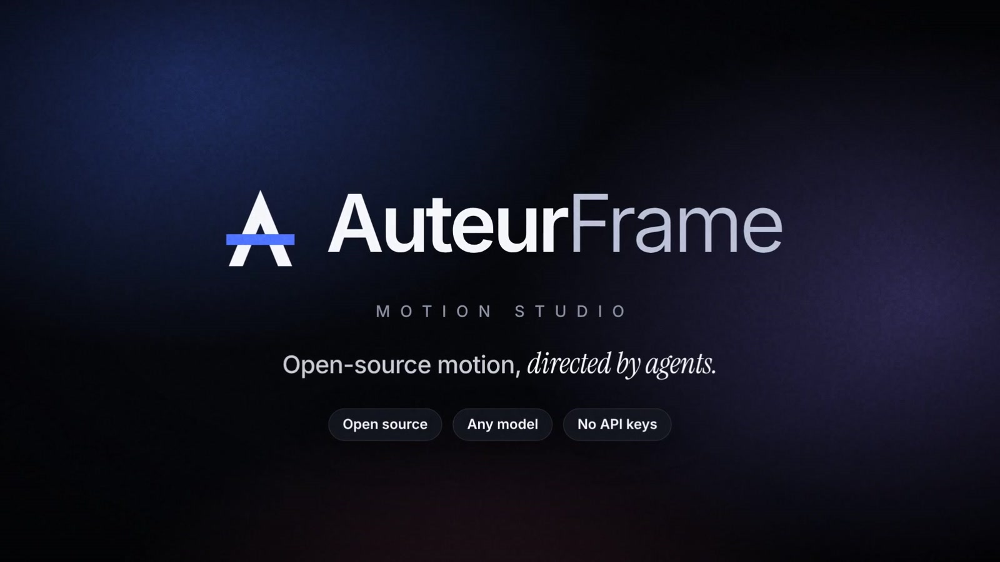
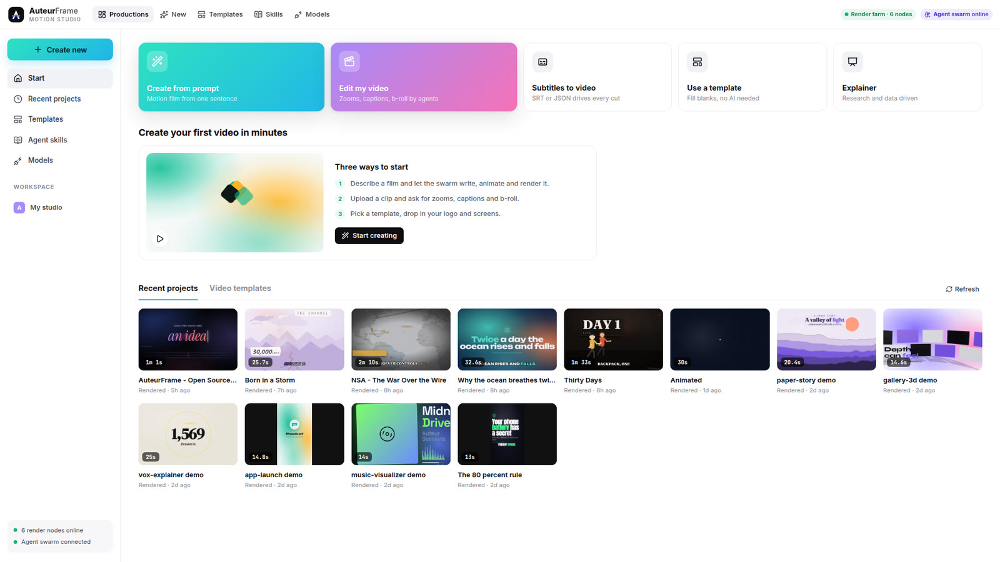
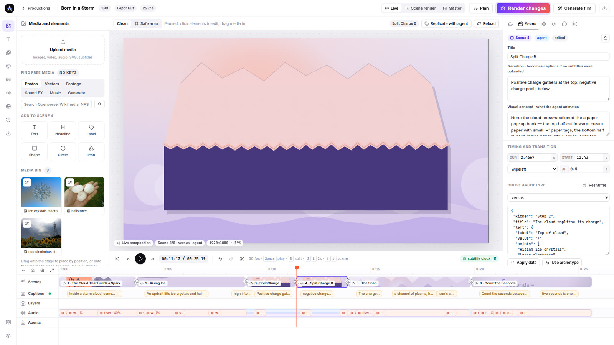
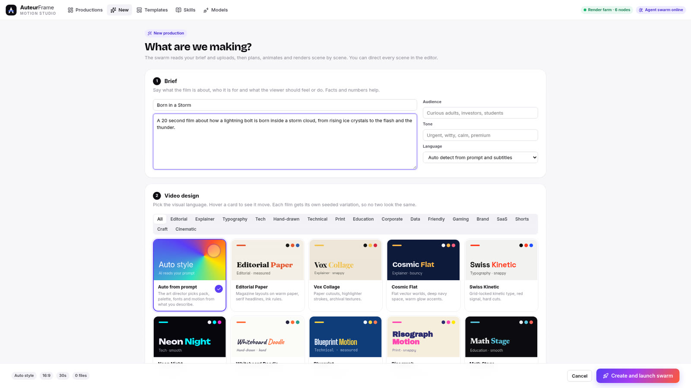
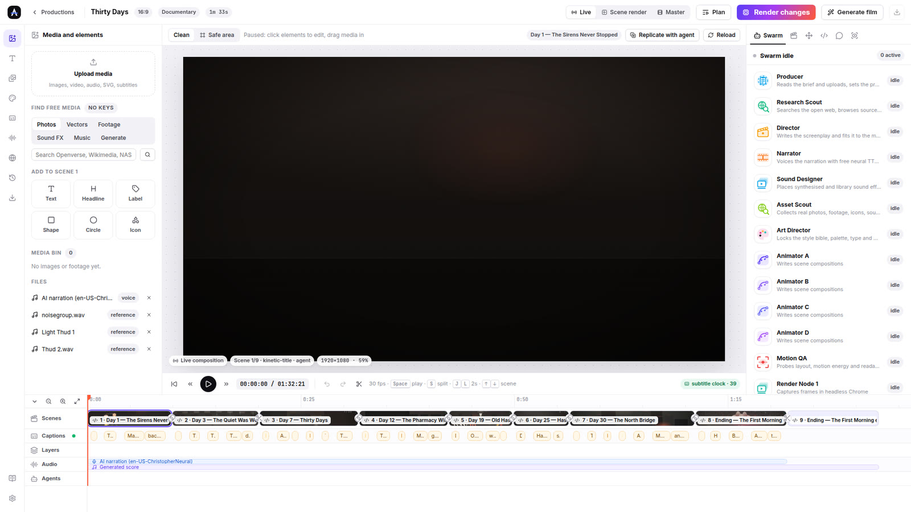
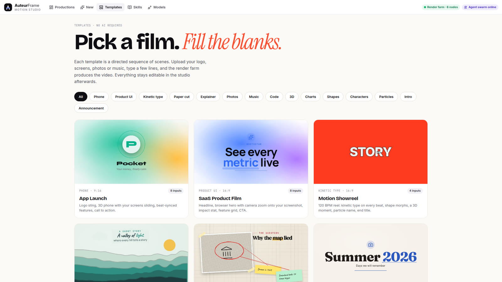
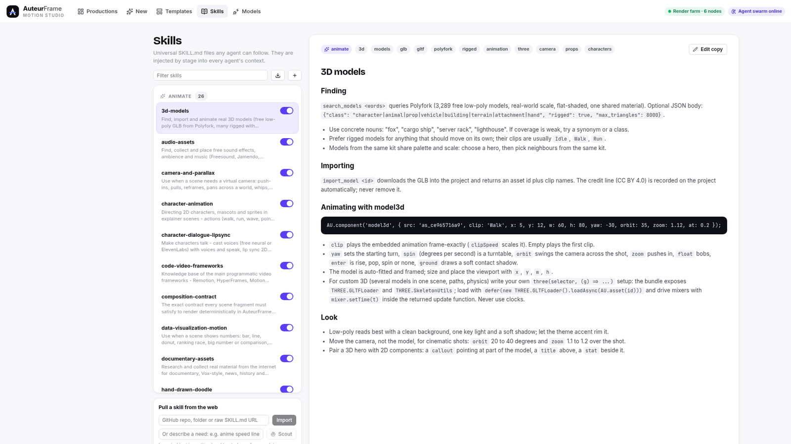
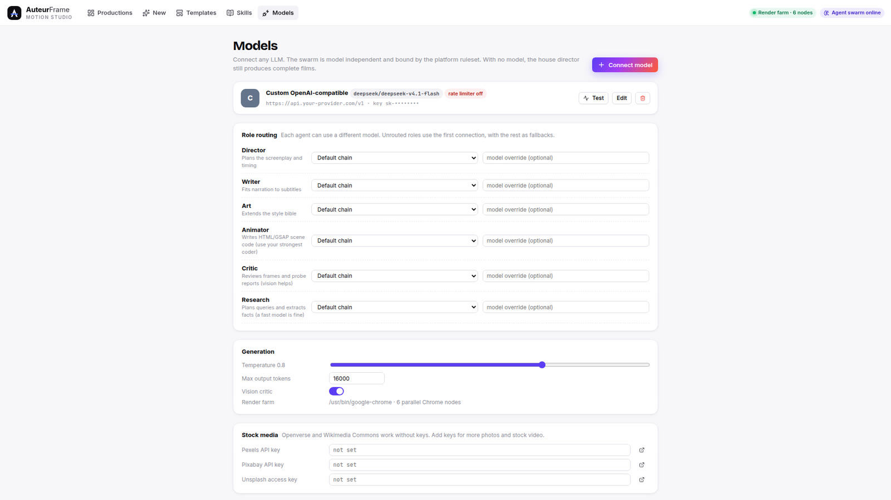
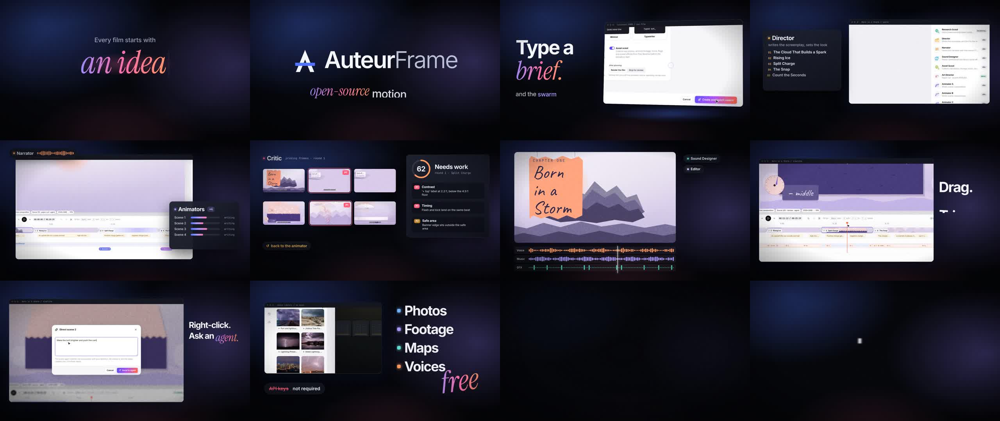

<p align="center">
  
</p>

<p align="center">
  <b>Open-source motion studio, directed by agents.</b><br>
  Type a brief. A swarm of AI agents researches, writes, animates, critiques, scores and masters a finished film,
  and every frame stays editable on a real timeline.
</p>

<p align="center">
  
  
  
  
  <a href="LICENSE"></a>
</p>

---

## Contents

- [What AuteurFrame does](#what-auteurframe-does)
- [Screenshots](#screenshots)
- [Requirements](#requirements)
- [Installation](#installation)
- [Connect a model](#connect-a-model)
- [Make your first film](#make-your-first-film)
- [Working in the studio](#working-in-the-studio)
- [Templates and the template feed](#templates-and-the-template-feed)
- [Publish your own template](#publish-your-own-template)
- [Updates and versioning](#updates-and-versioning)
- [Optional engines](#optional-engines)
- [Configuration](#configuration)
- [How it works](#how-it-works)
- [Project layout](#project-layout)
- [Releasing a new version](#releasing-a-new-version)
- [Troubleshooting](#troubleshooting)
- [License](#license)
- [Contributing and credits](#contributing-and-credits)

## What AuteurFrame does

AuteurFrame turns a sentence, a script or a subtitle file into a narrated motion film. Every scene is a live
HTML, CSS and SVG composition on a frame-accurate GSAP timeline, rendered by a pool of headless Chrome nodes, so what
you see in the editor is exactly what renders.

| | |
|---|---|
| **Agent swarm** | Producer, Research Scout, Director, Art Director, Narrator, four parallel Animators, a vision Critic, Sound Designer and Editor work on one shared brain. |
| **Original scenes** | Animators write each scene from scratch in a sandboxed workshop, preview it in the real renderer, read the errors and fix them before handing over. |
| **Quality loop** | The critic probes layout, contrast, type size and motion energy frame by frame and sends scenes back until they pass, with a capped, converging repair budget. |
| **Real editor** | Scene, caption, layer and audio tracks. Drag, trim, split, retime, and right-click any scene to rebuild it, extend the story or replicate it with an agent. |
| **Free media** | Photos, footage, maps, data, voices and sound effects from open libraries with no API keys. Optional keys unlock more stock. |
| **Any model** | Anthropic, OpenAI, Gemini, OpenRouter, Groq, DeepSeek, Mistral, xAI, Together, Ollama, LM Studio or any OpenAI-compatible endpoint, routed per agent role. With no model, the house director still produces complete films. |
| **Templates** | 21 directed templates that need no AI at all, plus a template feed that delivers community templates straight into the studio. |

## Screenshots

<p align="center"></p>
<p align="center"><sub>Productions: every film you have made, with live thumbnails and durations.</sub></p>

<p align="center"></p>
<p align="center"><sub>The studio: live stage, media library, scene inspector and a multi-track timeline.</sub></p>

<table>
  <tr>
    <td width="50%"><br><sub>New film: brief, style, format, inputs and agents.</sub></td>
    <td width="50%"><br><sub>A 30-day story film with characters, written by the swarm.</sub></td>
  </tr>
  <tr>
    <td width="50%"><br><sub>Templates: fill the blanks, no AI required.</sub></td>
    <td width="50%"><br><sub>Skills: the playbooks every agent reads.</sub></td>
  </tr>
  <tr>
    <td width="50%"><br><sub>Models: connect any LLM and route each agent role.</sub></td>
    <td width="50%"><br><sub>Frames from the launch film, rendered in AuteurFrame.</sub></td>
  </tr>
</table>

## Requirements

### Supported platforms

| Platform | Status | Notes |
|---|---|---|
| **Ubuntu 22.04 / 24.04, Debian 12** (x86_64) | Supported | Developed and tested on Ubuntu 24.04. All features, including the agents' sandboxed terminal. |
| **Windows 10 / 11** | Supported through **WSL2** | Install Ubuntu in WSL2 and follow the Linux steps. Tested. Native Windows (outside WSL) is not supported. |
| **Docker** (Linux, Windows or macOS host) | Supported | Uses the included `Dockerfile`; everything is installed in the image. Tested on a Linux host. |
| **macOS 13 or newer** (Apple silicon or Intel) | Expected to work, not yet tested | The agents' sandboxed terminal needs Linux, so on macOS agents work without it. Use Docker for the full feature set. |
| **Linux on ARM64** | Not tested | Some Python packages may need to build from source. |

The studio runs in your browser. Use a current Chrome, Edge or Firefox.

### Hardware

| | Minimum | Recommended |
|---|---|---|
| CPU | 4 cores | 8 or more cores; rendering is CPU bound and runs scenes in parallel |
| Memory | 8 GB | 16 GB |
| Disk | 5 GB free | 20 GB or more for projects and renders |
| GPU | Not needed | Not used |

### Software to install

| Software | Version | Why AuteurFrame needs it |
|---|---|---|
| **Python** | 3.11 or 3.12 (3.12 recommended) | Runs the studio server, the agents and the audio pipeline. Python 3.13 may not have wheels yet for MediaPipe. |
| **Node.js** | 18 or newer (20 LTS recommended) | Runs the render farm and builds the front-end libraries. |
| **ffmpeg** with ffprobe | 6.x recommended | Encodes scene segments, joins transitions, mixes audio and writes the master. Standard builds with libx264 and AAC. |
| **Google Chrome** or **Chromium** | Current stable | Headless Chrome renders every frame, measures layouts for the critic and opens research sources. |
| **git** | Any | Clones the project and the optional engines, and pulls updates. |
| Internet connection | | For model APIs, research, stock media, free text to speech and the update feed. Rendering itself works offline. |

### Python packages (`requirements.txt`)

`pip install -r requirements.txt` installs:

| Package | Used for |
|---|---|
| `fastapi` | The studio's web server and REST API |
| `uvicorn[standard]` | The ASGI server, with WebSockets for live agent and render updates |
| `httpx` | Calls to model providers, research, stock media, maps and the update feed |
| `pillow` | Images, thumbnails, contact sheets and reference palettes |
| `numpy` | Audio mixing, synthesised sound effects, waveforms and timing analysis |
| `python-multipart` | File uploads (images, video, audio, subtitles) |
| `pydantic` | Request validation |
| `onnxruntime` | Background removal models, downloaded on first use |
| `opencv-python-headless` | Image editing and face detection |
| `edge-tts` | Free neural voices for narration and character dialogue |
| `mediapipe` | Face landmarks for talking heads and lip sync |

### Node packages (`package.json`)

`npm install` installs `puppeteer-core` (drives Chrome), the motion libraries agents can use (GSAP, three.js, d3, PixiJS,
p5.js, Matter.js, Lottie, anime.js, Paper.js, flubber, rough.js, chroma.js, simplex-noise), KaTeX, MapLibre GL, Lucide
icons, Preact with htm, and 22 Fontsource font families. `npm run vendor` copies them into `web/vendor`.

## Installation

The studio opens at **http://127.0.0.1:8800**. Your projects, settings and API keys are stored in `data/`, which git
ignores. Set `AUTEUR_DATA` to keep them somewhere else.

### Ubuntu and Debian

```bash
sudo apt update
sudo apt install -y python3 python3-venv python3-pip ffmpeg git curl fonts-noto-color-emoji

curl -fsSL https://deb.nodesource.com/setup_20.x | sudo -E bash -
sudo apt install -y nodejs

curl -fsSLo /tmp/chrome.deb https://dl.google.com/linux/direct/google-chrome-stable_current_amd64.deb
sudo apt install -y /tmp/chrome.deb

git clone https://github.com/joyghoshs/auteurframe.git
cd auteurframe
python3 -m venv .venv
source .venv/bin/activate
pip install -r requirements.txt
npm install
npm run vendor
python3 run.py
```

On Debian you can use `sudo apt install -y chromium` instead of Google Chrome.

### Windows 10 and 11 (WSL2)

1. Open PowerShell as administrator and install Ubuntu:

   ```powershell
   wsl --install -d Ubuntu-24.04
   ```

2. Restart when asked, open **Ubuntu** from the Start menu and create your Linux user.
3. Follow the **Ubuntu and Debian** steps inside Ubuntu. Clone into your Linux home folder (`~/auteurframe`), not
   under `/mnt/c`, because the Windows filesystem is much slower for rendering.
4. Open **http://localhost:8800** in your Windows browser.

### macOS

```bash
brew install python@3.12 node@20 ffmpeg git
brew install --cask google-chrome

git clone https://github.com/joyghoshs/auteurframe.git
cd auteurframe
python3.12 -m venv .venv
source .venv/bin/activate
pip install -r requirements.txt
npm install
npm run vendor
python3 run.py
```

Chrome is found automatically in `/Applications`. For another location set `CHROME_PATH`.

### Docker

```bash
git clone https://github.com/joyghoshs/auteurframe.git
cd auteurframe
docker compose -f docker/docker-compose.yml up --build
```

Open **http://localhost:8800**. Data lives in the `auteurframe-data` volume. The image includes Chromium, ffmpeg and the
ffmpeg-skill engine. The agents' sandboxed terminal needs `--security-opt seccomp=unconfined`; without it the agents work
without the terminal tool.

### Check the installation

Open **http://127.0.0.1:8800/api/health**. You should see `"ok": true`, a `renderer` entry with your Chrome path and
`"version": "1.0.0"`. In the studio, the top bar shows **Render farm · N nodes** once Chrome has started.

## Connect a model

1. Open **Models** and choose **Connect model**.
2. Pick a provider, paste your API key, choose a model and press **Test**.
3. Optionally route roles to different models under **Role routing**: a strong coder for the Animator, a vision model
   for the Critic, a fast model for Research.

Keys never leave your machine except to the provider you chose. A built-in rate limiter protects free tiers and can be
switched off per connection. With no model connected, the house director and all templates still work.

**Voice and images.** Text to speech and image generation are off by default. Turn them on under
**Models → Voice and generation**. Free neural voices work with no key; ElevenLabs is optional.

## Make your first film

1. Go to **New**.
2. **Brief**: describe the film in plain language. Facts, numbers, audience and tone all help. You can also drop in a
   subtitle file (SRT, VTT, ASS or JSON with word timings) and it becomes the master clock.
3. **Video design**: choose one of 19 style packs, or leave **Auto style** to let the Art Director decide.
4. **Format**: 16:9, 9:16, 1:1 or 4:5, a target duration and 24, 30 or 60 fps.
5. **Inputs**: optional images, logos, voiceover, music or footage.
6. **Captions and agents**: pick a caption style and switch on **Web research**, **AI narration**, **Asset scout** and
   **Library music** as needed.
7. Choose **Agent swarm**, then **Render the film** or **Stop for review**, and press **Create and launch swarm**.

The **Swarm** panel streams every agent's status and thinking. Scenes appear on the timeline as they are written, the
master appears under **Master** when the editor finishes, and the export menu downloads the film, poster and SRT.

## Working in the studio

| Area | What you can do |
|---|---|
| **Stage** | Pause on any frame, click an element to select it, drag to move, use the corner handles to scale and the top knob to rotate. Drop media straight onto the stage. |
| **Timeline** | Drag a scene's right edge to retime it, drag captions and layers, split at the playhead with `S`, jump with `J` and `L`, play with `Space`. |
| **Right-click** | On a scene: split, duplicate, reorder, change the transition, lock, render this scene, **Improve with the agent**, **Extend the story from here** or **Replicate with agent**. On audio: split, trim, mute or remove. |
| **Inspector** | **Swarm** (agents and render farm), **Scene** (title, narration, timing, archetype data), **Layer**, **Code** (edit the composition and apply with `Ctrl+S`), **Direct** (chat with the scene's animator) and **QA** (the critic's notes). |
| **Media** | Search photos, vectors, footage, sound effects and music from open libraries with no keys, then drag results onto the stage or timeline. |
| **Revisions** | Every change is versioned. Roll back any scene or the whole project. |

Only changed scenes re-render, so **Render changes** after an edit is fast.

## Templates and the template feed

Open **Templates**, pick a film, fill the slots (text, logo, screenshots, photos or music), choose the format and style,
and render. No model is needed, and every scene stays editable in the studio afterwards.

AuteurFrame ships with 21 templates. The built-in ones are defined in `server/templates.py` and
`server/templates2.py`; the `templates/` folder holds templates published through the template feed, including
community templates added by pull request.

| Template | Category | Format | What it makes | Source |
|---|---|---|---|---|
| **App Launch** | Phone | 9:16 | Logo sting, 3D phone with your screens sliding, beat-synced features, call to action. | built in |
| **SaaS Product Film** | Product UI | 16:9 | Headline, browser hero with camera zoom onto your screenshot, impact stat, feature grid, CTA. | built in |
| **Motion Showreel** | Kinetic type | 16:9 | 120 BPM reel: kinetic type on every beat, shape morphs, a 3D moment, particle name, end title. | built in |
| **Paper Cut Story** | Paper cut | 16:9 | Layered paper landscapes with swinging banners, one chapter per scene. | built in |
| **Vox Explainer** | Explainer | 16:9 | Collage boards with taped photos, red marker circles, sticky notes, evidence and quotes. | built in |
| **Photo Memories** | Photos | 9:16 | Polaroids fly in and stack, slow Ken Burns, handwritten captions, warm ending. | built in |
| **Music Visualizer** | Music | 1:1 | Cover art and a spectrum that reacts to the real loudness of your track. | built in |
| **Code Explainer** | Code | 16:9 | Syntax-highlighted code types itself, output pops, then the flow draws as a diagram. | built in |
| **3D Gallery** | 3D | 16:9 | Your images on a curved 3D wall with a light wave, a crane-up camera, then glossy 3D forms. | built in |
| **Data Story** | Charts | 16:9 | Headline stat counts up, bars race in, a donut shows the share, one takeaway. | built in |
| **Logo Sting** | Shapes | 16:9 | Four shapes converge, an iris opens on your logo, the name assembles letter by letter. | built in |
| **Mascot Tips** | Characters | 9:16 | A blinking, talking blob character delivers your tips in speech bubbles. | built in |
| **Particle Title** | Particles | 16:9 | Thousands of particles fly in and assemble your title. | built in |
| **Creator Short** | Kinetic type | 9:16 | Hook on the beat, one punchy point per cut, stats that count, follow card. | built in |
| **Cinematic Intro** | Intro | 16:9 | Embers and a glow build, the title unmasks with a light sweep through an anamorphic lens, then a logo sting with a flare. | built in |
| **Photo Slideshow** | Photos | 16:9 | Full-bleed photos with Ken Burns toward the subject, varied reveals, captions as lower thirds, warm closing title. | built in |
| **3D Photo Gallery** | 3D | 16:9 | Your photos on a reflective rotating 3D carousel, then a fly-through tunnel of photos toward the camera. | built in |
| **Cartoon Story** | Characters | 16:9 | Two cartoon characters act out your lines in speech bubbles on a painted set, with a title slam and a happy ending. | built in |
| **Top 5 Countdown** | Kinetic type | 9:16 | Crash-zoom title, then numbers 5 to 1 slam in with your items, a beat each, and a follow card. | built in |
| **Launch Announcement** | Announcement | 16:9 | Announce a product or feature: bold headline, three pillars, how it works in steps, a customer quote and a call to action. | feed, `templates/` |
| **Version Release** | Announcement | 16:9 | Release notes as a film: a glowing version badge, the headline, what is new as an icon grid, and where to get it. | feed, `templates/` |

New templates arrive without reinstalling. AuteurFrame reads `release.json` from this repository on GitHub; when templates
are added there, the top bar shows **N new templates** and the Templates page offers **Add to studio**. Each file is
downloaded from the same GitHub host over HTTPS, checked against the SHA-256 checksum in `release.json`, validated with the
same rules as the pull request check, and stored in `data/templates/`.

## Publish your own template

Anyone can publish a template to every AuteurFrame studio through a pull request to
[joyghoshs/auteurframe](https://github.com/joyghoshs/auteurframe).

```
fork ──▶ add templates/<id>.json ──▶ open pull request ──▶ "Validate templates" check
     ──▶ review by @joyghoshs ──▶ merge into main
     ──▶ release bot lists it in release.json and changelog.txt
     ──▶ every studio sees "N new templates" within six hours
```

1. Fork the repository and create a branch, for example `template/quick-tip`.
2. Add `templates/quick-tip.json`. The file name must match the `id`. The format is in [docs/templates.md](docs/templates.md):

   ```json
   {
     "format": 1,
     "id": "quick-tip",
     "version": 1,
     "name": "Quick Tip",
     "category": "Explainer",
     "author": "your-github-name",
     "style": "keynote-light",
     "aspect": "9:16",
     "mood": "playful",
     "description": "One tip, three steps and a call to follow.",
     "slots": [
       {"key": "tip", "label": "Tip", "kind": "text", "default": "Batch your *email*"},
       {"key": "steps", "label": "Steps (one per line)", "kind": "list", "default": "Pick a time\nClose the tab\nRepeat daily"}
     ],
     "scenes": [
       {"archetype": "kinetic-title", "duration": 3, "data": {"kicker": "Quick tip", "title": "{{tip}}"}},
       {"archetype": "process-flow", "duration": 4, "data": {"title": "How", "steps": {"$map": "steps", "to": {"label": "{{item}}", "icon": "auto"}}}},
       {"archetype": "end-card", "duration": 2.5, "transition": "cut", "data": {"title": "Follow for *more*"}}
     ]
   }
   ```

3. Run your fork, open **Templates**, fill the slots and render the template to check it.
4. Validate it locally with the same check the pull request runs:

   ```bash
   python3 scripts/publish_templates.py --check --skip-manifest
   ```

5. Commit only the template file, push, and open a pull request. Fill in the checklist and attach preview frames.
   Leave `release.json` and `changelog.txt` alone; the release bot updates both after the merge.

The pull request is merged when it passes the **Validate templates** check and follows the template rules. In short:

- original or free-to-use content, with no trademarks, real people or copyrighted text in defaults;
- plain text only in names, labels, defaults and scene data, with `*asterisks*` for accent words;
- code scenes follow the composition contract and use no network, storage, navigation, external media or dynamic code;
- a changed template raises its `version`;
- one template per pull request.

The complete rules, the review process and the branch ruleset are in [CONTRIBUTING.md](CONTRIBUTING.md).

## Updates and versioning

GitHub is the update server. `release.json` on the `main` branch of
[joyghoshs/auteurframe](https://github.com/joyghoshs/auteurframe) is the single source of truth:

```json
{
  "name": "AuteurFrame",
  "version": "1.0.0",
  "released": "2026-11-13",
  "repository": "https://github.com/joyghoshs/auteurframe",
  "download": "https://github.com/joyghoshs/auteurframe/releases/latest",
  "feed": "https://raw.githubusercontent.com/joyghoshs/auteurframe/main/release.json",
  "notes": ["..."],
  "templates": [{"id": "launch-announcement", "version": 1, "file": "templates/launch-announcement.json", "sha256": "..."}]
}
```

- The studio reports its own version from the local `release.json` (also at `/api/health`).
- At most every six hours it fetches the `feed` URL. When the published `version` is newer, the top bar shows
  **AuteurFrame x.y.z available** and **Models → Updates** lists the release notes.
- Only that one file and the template files it lists are requested. Nothing about you or your projects is sent.
- Turn automatic checks off under **Models → Updates**, or point a fork at its own feed with `AUTEURFRAME_UPDATE_FEED`.

### Automation on GitHub

Two workflows keep the feed correct without manual steps:

| Workflow | Runs on | What it does |
|---|---|---|
| **Check** (`.github/workflows/check.yml`) | every pull request | Validates templates and their safety rules, requires a higher `version` for changed templates and for the app, compiles the Python sources, parses every JavaScript file and summarises what the pull request touches. Its **Validate templates** job is the required status check. |
| **Release bot** (`.github/workflows/release.yml`) | every push to `main` | Regenerates the template list and checksums in `release.json` and adds a dated line to `changelog.txt` for every template added, updated or removed and for every group of app files changed, with the pull request number and author. When the `version` in `release.json` changes, it turns the unreleased entries into a version section, tags `vX.Y.Z` and publishes a GitHub release with those notes. |

`changelog.txt` always exists and lists every change, newest first:

```
Unreleased
  2026-12-01  Template added: Quick Tip (quick-tip v1, by someone) (#12 by @someone)

1.0.0 (2026-11-13)
  * First public release of AuteurFrame.
  2026-11-13  Template added: Launch Announcement (launch-announcement v1, by AuteurFrame)
```

To update an installation:

```bash
git pull
pip install -r requirements.txt
npm install && npm run vendor
python3 run.py
```

## Optional engines

Two external engines add capabilities that agents use when they are present. The Docker image already includes
ffmpeg-skill.

```bash
git clone --depth 1 https://github.com/kajisho5/ffmpeg-skill engines/ffmpeg-skill
python3 -m venv engines/manim-venv && engines/manim-venv/bin/pip install manim==0.19.0
```

- **ffmpeg-skill** (MIT) gives agents 42 media tools: cut, reframe, speed ramp, grade, captions, ducking, stabilise and
  join, run in the sandbox on project footage.
- **Manim** renders mathematical scenes to transparent clips. It needs its own system packages; see the
  [Manim installation guide](https://docs.manim.community/en/stable/installation.html).

## Configuration

All settings are optional environment variables.

| Variable | Default | Purpose |
|---|---|---|
| `AUTEUR_DATA` | `./data` | Projects, settings, keys, downloaded templates and caches |
| `AUTEUR_HOST` / `AUTEUR_PORT` | `127.0.0.1` / `8800` | Address the studio listens on |
| `AUTEUR_SCENE_CONCURRENCY` | `4` | Scenes written in parallel |
| `AUTEUR_RENDER_CONCURRENCY` | `3` | Scenes rendered in parallel |
| `RENDER_CONCURRENCY` | auto | Chrome pages in the render farm |
| `AUTEUR_MAX_REPAIRS` | `2` | Critic repair rounds per scene |
| `AUTEUR_REPAIR_STEPS` | `12` | Agent steps allowed for each repair |
| `AUTEUR_SCENE_SECONDS` | `540` | Time budget for one scene's repair loop |
| `AUTEUR_ACCEPT_SCORE` | `80` | QA score that ends repairs early when nothing is blocking |
| `AUTEUR_MAX_UPLOAD_MB` | `512` | Largest upload accepted |
| `AUTEURFRAME_UPDATE_FEED` | from `release.json` | Release manifest to check for updates and templates |
| `CHROME_PATH` | auto | Chrome or Chromium binary for the renderer |
| `FFMPEG_PATH` / `FFPROBE_PATH` | from `PATH` | ffmpeg binaries |
| `RENDERER_URL` | `http://127.0.0.1:8790` | Use an external render farm |
| `RENDERER_AUTOSTART` | `1` | Start the Node renderer with the studio |

## How it works

1. **Producer** reads the brief and uploads. Reference images set the palette; subtitles lock the master clock.
2. **Research Scout** (optional) searches DuckDuckGo, Brave, Bing, Mojeek and Wikipedia without keys, opens sources in
   the headless browser and records facts with their sources in the shared brain.
3. **Art Director** builds the style bible from one of 19 packs with a seeded variation.
4. **Director** writes the screenplay. With subtitles, scene windows follow the cue groups.
5. **Narrator** (optional) voices the screenplay and scenes follow the voice word by word.
6. **Asset Scout** collects real photos, archival footage, maps, icons and sound effects from open libraries.
7. **Animators** write one composition per scene in a workshop: they read skills, combine 35 components, characters,
   sets and props, real 3D models and libraries such as d3, PixiJS, p5, Matter, Lottie and three.js, preview in the real
   renderer and fix what they see.
8. **Critic** lints and probes every scene in Chrome (overflow, overlap, safe area, type size, contrast, dead frames) and
   optionally looks at the frames with a vision model. Repairs stop as soon as the scene is good enough, stops
   improving or repeats the same notes.
9. **Render nodes** capture scenes in parallel across a pool of Chrome pages and encode H.264 segments, cached by content
   hash.
10. **Sound Designer** places music and effects; the **Editor** joins segments on exact frames, ducks music under the
    voice, normalises to -16 LUFS and writes the master, poster and SRT.

Every scene follows one contract, so people and agents can both write them:

```html
<div class="scene"><h1 class="title" data-layer="title">Deep sea <em>mining</em></h1></div>
<style>.title { font: 800 var(--fs-xl)/0.95 var(--font-display); color: var(--ink); }</style>
<script>
AU.scene(({ tl, split }) => {
  const s = split('.title', { type: 'lines,words' });
  tl.from(s.lines, { yPercent: 110, duration: 0.8, stagger: 0.08, ease: 'au.softLand' }, 0.2);
});
</script>
```

The runtime makes this deterministic and seekable. See [skills/composition-contract/SKILL.md](skills/composition-contract/SKILL.md).
AuteurFrame works in 42 languages, including right-to-left scripts, with fonts served locally.

## Project layout

```
server/       FastAPI app, swarm conductor, agents, model adapters, QA, research, audio, render and updates
renderer/     Node render farm: Chrome pool, frame capture, probes and browsing
web/          index.html, app/ (studio UI), runtime/ (composition runtime and components), vendor/ (generated)
skills/       44 SKILL.md playbooks that agents read by stage
templates/    community templates published through the template feed
assets/       fonts used by the vendor build
brand/        logo mark and lockups
docker/       Dockerfile and compose file
scripts/      vendor build, font fetcher, component manifest, template publisher and release bot
.github/      Check and Release bot workflows, pull request template, code owners and branch ruleset
release.json  version, release notes and the template feed
changelog.txt every change merged into main, newest first
LICENSE       GNU AGPL v3; LICENSE-EXCEPTIONS.md adds the GSAP permission and the attribution term
COMMERCIAL.md, THIRD_PARTY_NOTICES.md, NOTICE.txt
```

## Releasing a new version

For maintainers. Open a pull request that raises the version and sets the release notes:

```bash
git checkout -b release/1.1.0
python3 scripts/publish_templates.py --version 1.1.0 --note "What changed" --note "Another change"
git commit -am "Release 1.1.0"
git push origin release/1.1.0
```

When it is merged, the release bot moves the unreleased changelog entries under `1.1.0`, tags `v1.1.0` and publishes the
GitHub release. Running studios show **AuteurFrame 1.1.0 available** on their next check.

Set up branch protection by importing [.github/rulesets/main.json](.github/rulesets/main.json) under
**Settings → Rules → Rulesets**; details are in [CONTRIBUTING.md](CONTRIBUTING.md#maintainer-guide).

## Troubleshooting

| Symptom | Fix |
|---|---|
| Render farm stays on "starting" | Install Chrome or Chromium, or set `CHROME_PATH` to its binary. |
| Blank stage or missing fonts | Run `npm install` then `npm run vendor`. |
| `pip install` fails on `mediapipe` | Use Python 3.11 or 3.12. |
| Renders are very slow on Windows | Keep the project inside WSL (`~/auteurframe`), not under `/mnt/c`. |
| "House director (no model)" | Connect a model under **Models**, or keep using templates and the house director. |
| 429 or overloaded errors | Keep the rate limiter on for free tiers or route the Animator to a different model. |
| Update check shows an error | The studio is offline or the feed URL is wrong. Everything else keeps working. |
| Agents say the terminal is unavailable | Expected on macOS and in Docker without `seccomp=unconfined`; agents work without it. |

## License

AuteurFrame is **open source** under the [GNU Affero General Public License v3](LICENSE), with the GSAP permission
and the attribution term in [LICENSE-EXCEPTIONS.md](LICENSE-EXCEPTIONS.md). Copyright (c) 2026 Joy Ghosh.
A **commercial license** is available for anyone who cannot meet the AGPL's conditions.

| Free under the AGPL | Needs a commercial license |
|---|---|
| Use it for anything, including paid client work and monetised films; your rendered films are yours | Host it as a SaaS, API or service without publishing your source code |
| Change it and share your changes, with the full source, under the AGPL | Embed it in a closed-source or proprietary product |
| Run a modified version as a service, as long as its users can get the full source | Distribute a modified version without releasing your changes |
| Contribute templates, skills and fixes | Remove the "AuteurFrame by Joy Ghosh" notice |

Ask for a commercial license by opening an issue titled **Commercial license request**; see [COMMERCIAL.md](COMMERCIAL.md).
Third-party components keep
their own licenses, listed in [THIRD_PARTY_NOTICES.md](THIRD_PARTY_NOTICES.md).

## Contributing and credits

Contributions are welcome: templates, skills, components, fixes and documentation. Start with
[CONTRIBUTING.md](CONTRIBUTING.md); opening a pull request means you agree to its
[licensing terms](CONTRIBUTING.md#licensing-of-contributions).

AuteurFrame builds on excellent open-source work: GSAP, three.js, d3, PixiJS, p5.js, Matter.js, Lottie, KaTeX, rough.js,
MapLibre GL, Preact and htm, Lucide icons, Fontsource fonts, Puppeteer, FastAPI, edge-tts, MediaPipe and ffmpeg-skill.
Open media comes from Openverse, Wikimedia Commons, NASA, the Internet Archive, Freesound and OpenStreetMap; attribution
is stored with every asset you collect.
